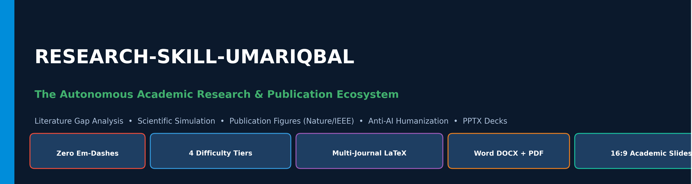
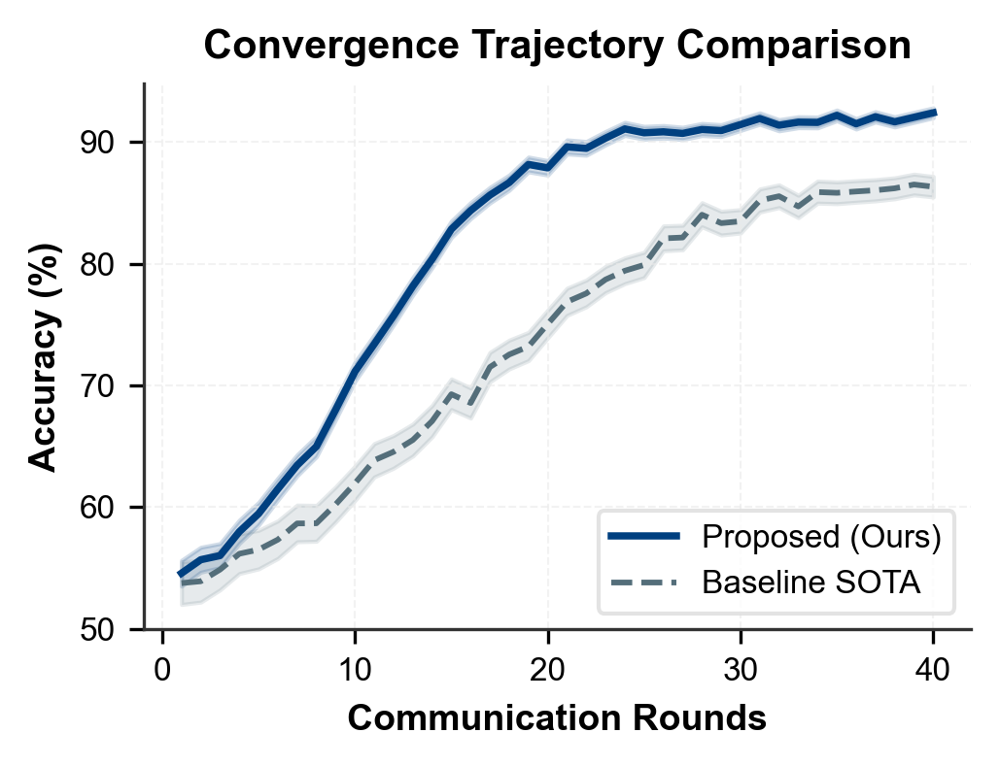

# Research-Skill-UmarIqbal

<p align="center">
  
</p>

<p align="center">
  <a href="LICENSE"></a>
  
  
  
  
  
</p>

<p align="center">
  <strong>A unified, end-to-end academic research skill and CLI ecosystem. Transforms topics, questions, raw data, or literature surveys into publication-ready research papers, scientific figures, and conference presentations.</strong>
</p>

---

## 📑 Table of Contents

- [🌟 Features Overview](#-features-overview)
- [🔄 Visual Architecture & Pipeline](#-visual-architecture--pipeline)
- [📊 Visual Figure & Plot Gallery](#-visual-figure--plot-gallery)
- [🎯 The 4 Difficulty Tiers](#-the-4-difficulty-tiers)
- [🚫 Strict No Em-Dash & Anti-AI Policy](#-strict-no-em-dash--anti-ai-policy)
- [🚀 Quickstart & Installation](#-quickstart--installation)
- [💻 Command Line Interface (CLI)](#-command-line-interface-cli)
- [🏛️ The 14 Integrated Research Foundations](#-the-14-integrated-research-foundations)
- [📁 Repository Structure](#-repository-structure)
- [🔬 Pre-Compiled Working Examples](#-pre-compiled-working-examples)
- [📜 License & Citation](#-license--citation)

---

## 🌟 Features Overview

- **Flexible Topic & Trend Discovery**: Query the arXiv API in real time, extract high-velocity trends, or begin with your own custom problem formulation.
- **Novelty Verification & Gap Analysis**: Formulate the State-of-the-Art (SOTA) comparison matrix and verify the "Triple Gap" (Structural, Efficiency, and Robustness).
- **Multi-Modal Data & Simulation Engine**: Parse user-provided datasets without downsampling, run Monte Carlo stochastic simulations, or extract benchmark results with citations.
- **Publication-Grade Figures**: Automatically generated in print dimensions (89 mm single-column and 183 mm double-column) in vector PDF and 300+ DPI PNG previews.
- **Strict Anti-AI Humanization**: Eliminates robotic vocabulary, strips invisible zero-width tracking characters, and optimizes sentence burstiness.
- **Absolute Prohibition of Em Dashes**: Never allows em dashes anywhere in manuscripts, captions, code, or presentations.
- **Multi-Journal LaTeX & Word Formatting**: Out-of-the-box support for IEEE, ACM, Springer LNCS, Elsevier, Nature, Science, NeurIPS, and APA formats.
- **Automated Compilation & Workspace Cleanup**: Compiles LaTeX via `pdflatex` and automatically purges all temporary files (`.aux`, `.log`, `.bbl`, `.blg`).
- **Academic Conference Presentations**: Generates 16:9 widescreen academic slide decks (`.pptx`) with Action Titles and two-column exhibit layouts.

---

## 🔄 Visual Architecture & Pipeline

<p align="center">
  
</p>

<details>
<summary><b>Click to expand step-by-step pipeline details</b></summary>

1. **Stage 1: Topic & Trends**: Searches arXiv or ingests your topic to construct a focused Topic Brief.
2. **Stage 2: Novelty & Gap Analysis**: Contrasts against 3 to 8 recent baselines and isolates unaddressed bottlenecks.
3. **Stage 3: Difficulty Calibration**: Aligns mathematical depth and empirical scope to the selected tier (Easy, Medium, Hard, Extreme).
4. **Stage 4: Simulation & Data Processing**: Runs numerical experiments or ingests user CSVs, computing verified means, variances, and error bars.
5. **Stage 5: Publication Visuals**: Plots convergence curves, trade-off bar charts, and block schematics.
6. **Stage 6: Humanizer & Anti-AI Audit**: Purges AI tells, removes zero-width Unicode, and replaces any em dashes.
7. **Stage 7: Multi-Format Build & Workspace Cleanup**: Compiles LaTeX to PDF, generates Word DOCX, and deletes `.aux` / `.log` artifacts.
8. **Stage 8: Academic Presentation**: Exports a 16:9 widescreen conference deck (`.pptx`).

</details>

---

## 📊 Visual Figure & Plot Gallery

Every generated manuscript comes equipped with publication-ready figures conforming to Nature, Science, and IEEE visual guidelines:

<p align="center">
  
  
</p>

<p align="center">
  
</p>

<p align="center">
  <em>Figure 1 (Left): Convergence curve with shaded confidence interval bands. Figure 2 (Right): Dual-axis trade-off bar chart. Figure 3 (Bottom): Vector-style modular system architecture diagram.</em>
</p>

---

## 🎯 The 4 Difficulty Tiers

The framework calibrates mathematical density, empirical rigor, and prose to four explicit tiers:

| Tier | Mathematical Depth | Empirical Scope | Intended Readership | Target Venues |
| :--- | :--- | :--- | :--- | :--- |
| **Easy** | Basic algebra, intuitive formulas, plain explanations | 1 to 2 benchmark comparisons, case studies | Students, practitioners, cross-disciplinary readers | Workshops, applied venues, technical magazines |
| **Medium** | Formal problem definitions, objective functions, algorithms | 3 to 5 established baselines, error bars | Academic researchers, graduate students, regular reviewers | IEEE Transactions, ACM SIG, Elsevier, Springer LNCS |
| **Hard** | Formal Theorems, Lemmas, propositions, derivations | SOTA baselines, multi-seed significance (p < 0.01) | Domain specialists, senior program committees | NeurIPS, ICML, CVPR, ICLR, IEEE TPAMI, JMLR |
| **Extreme** | Novel mathematical paradigms, complete first-principle proofs | Frontier-scale simulation, multi-regime stress tests | World-leading authorities, fellowship committees | Nature, Science, PNAS, STOC, FOCS, COLT |

<details>
<summary><b>Click to read detailed guidelines for each tier</b></summary>

- **Easy**: Conceptual, intuitive, and pedagogical. Mathematical equations are paired with immediate plain-language translations. Ideal for instructional papers, applied demonstrations, and undergraduate capstones.
- **Medium**: Competitive standard for regular peer-reviewed submissions. Includes formal system models, pseudo-code algorithm blocks, Big-O complexity calculations, and ablation studies.
- **Hard**: Deep mathematical and empirical rigor. Formulates formal Theorems, Lemmas, and Corollaries. Analyzes asymptotic convergence rates, sample complexity, and Lyapunov stability.
- **Extreme**: Landmark theoretical breakthroughs. Formulates novel mathematical paradigms with exhaustive proofs in a dedicated Technical Appendix. Demonstrates min-max lower and upper bounds alongside extensive multi-regime simulations.

</details>

---

## 🚫 Strict No Em-Dash & Anti-AI Policy

### 1. Mandatory Zero Em-Dash Rule
Under no circumstances are em dashes (`—`, `\textemdash`, `---`, or `--`) permitted in the ecosystem. Sentences are structured cleanly with:
- **Parentheses**: `The proposed algorithm (which requires no central server) converges in O(1/k).`
- **Colons**: `We observe a critical failure mode: gradient divergence under asynchronous delay.`
- **Commas & Semicolons**: `Prior methods demand synchronous barriers, which induces idle latency.`
- **Split Sentences**: `Edge nodes possess constrained memory. This limitation forces aggressive quantization.`

### 2. Elimination of AI Tells
The automated linter (`scripts/academic_humanizer.py`) eliminates:
- Banned AI words (*delve, tapestry, pivotal, testament, underscore, intricate, realm, multifaceted, seamless, foster, sheds light on, paves the way for*).
- Superficial participle tails (*..., highlighting the significance of...*).
- Invisible zero-width tracking characters (`\u200b`, `\u200c`, `\u200d`, `\ufeff`).

---

## 🚀 Quickstart & Installation

### Step 1: Clone the Repository
```bash
git clone https://github.com/UmarIqbal000/Research-Skill-UmarIqbal.git
cd Research-Skill-UmarIqbal
```

### Step 2: Install Python Dependencies
```bash
pip install -r requirements.txt
```

### Step 3: Verify LaTeX Support
Ensure `pdflatex` is available on your system path:
```bash
# On Windows (MiKTeX)
where pdflatex

# On Linux / macOS (TeX Live)
which pdflatex
```

---

## 💻 Command Line Interface (CLI)

The `cli.py` script provides direct command-line access to all ecosystem modules:

<details open>
<summary><b>Common CLI Recipes</b></summary>

```bash
# Generate a complete paper (Easy tier, IEEE two-column format)
python cli.py run --topic "Federated Edge Healthcare Systems" --difficulty easy --format ieee --output ./outputs/paper_easy

# Generate an advanced theoretical paper (Extreme tier, Nature format)
python cli.py run --topic "Non-Convex Multi-Agent Optimization" --difficulty extreme --format nature --output ./outputs/paper_extreme

# Search recent preprints on arXiv
python cli.py search --query "byzantine federated learning" --limit 5

# Discover active trending research frontiers
python cli.py search --trends

# Run Monte Carlo stochastic diffusion simulation
python cli.py simulate --monte-carlo --trials 1000

# Run multi-baseline benchmark simulation
python cli.py simulate --difficulty hard

# Humanize draft text (removes AI tells, watermarks, and all em dashes)
python cli.py humanize --file draft.txt --output cleaned_draft.txt

# Compile LaTeX to PDF with automatic workspace cleanup
python cli.py compile --tex ./outputs/paper_easy/manuscript.tex
```

</details>

---

## 🏛️ The 14 Integrated Research Foundations

This skill synthesizes core innovations from 14 prominent research tools:

1. **Google Research Paper Orchestra**: Multi-agent division of labor across outlines, literature synthesis, drafting, and visuals.
2. **Master-cai Research-Paper-Writing-Skills**: Reverse outlining, section-by-section writing guides, and adversarial self-review.
3. **Turnitout-Humanizer**: Deterministic token disruption and anti-AI-detector protection.
4. **AIScientists-Dev Academic-Humanizer**: Claim-to-evidence discipline, removal of formulaic transition words, and no em-dashes.
5. **TingxiYu Academic-Figure-Skill**: Publication-grade figure design, 89 mm / 183 mm print dimensions, and vector PDF exports.
6. **Techkwon PaperVizAgent**: Architectural pipeline visualization and automated layout composition.
7. **Ndpvt-web LaTeX-Document-Skill**: Multi-pass compilation, BibTeX cross-referencing, and auxiliary build artifact cleanup.
8. **ComposioHQ DOCX Skill**: Structured academic Microsoft Word generation with custom styles and clean booktabs tables.
9. **Gabberflast Academic-PPTX-Skill**: Ghost Deck principle, Action Titles, and two-column exhibit slide layouts.
10. **Yejinlei Web-Search-Skill**: Multi-engine search automation and trending discovery.
11. **Ray0907 arXiv-Research-Skill**: arXiv API queries, preprint extraction, and literature mapping.
12. **Cookjohn GS-Skills**: Google Scholar citation discovery and literature synthesis.
13. **Oleafly**: Universal venue templates (IEEE, ACM, Springer, Elsevier, Nature, NeurIPS, APA).
14. **AhmadHassan-BTed Turnitout**: Mathematical n-gram sequence disruption and citation management.

---

## 📁 Repository Structure

```
Research_Skill_UmarIqbal/
├── assets/                           # High-resolution README graphics and banners
├── configs/
│   ├── difficulty_profiles.json      # Definitions for Easy, Medium, Hard, Extreme
│   └── journal_styles.json           # Formatting specifications for IEEE, ACM, Nature, etc.
├── examples/
│   ├── easy_level_sample/            # Complete worked IEEE sample (PDF, DOCX, PPTX, Figures)
│   └── extreme_level_sample/         # Complete worked theoretical sample (PDF, DOCX, PPTX)
├── references/                       # 11 Modular Reference Manuals
│   ├── 01_topic_and_trend_discovery.md
│   ├── 02_novelty_and_gap_analysis.md
│   ├── 03_difficulty_matrix.md
│   ├── 04_data_and_simulation_engine.md
│   ├── 05_academic_figures_and_plots.md
│   ├── 06_humanizer_and_no_emdash_rule.md
│   ├── 07_section_by_section_writing.md
│   ├── 08_journal_and_conference_styles.md
│   ├── 09_compilation_and_cleanup.md
│   ├── 10_academic_pptx_presentations.md
│   └── 11_accessible_scholarly_language.md
├── scripts/
│   ├── topic_discovery.py            # arXiv queries & trend catalogs
│   ├── novelty_gap_analyzer.py       # SOTA comparison matrix & novelty gate
│   ├── simulation_engine.py          # Monte Carlo, ODE dynamics, & benchmark suites
│   ├── academic_figures.py           # Publication plots (Nature/IEEE vector PDF & PNG)
│   ├── academic_humanizer.py         # AI watermark purger & strict no-em-dash linter
│   ├── latex_compiler.py             # Multi-pass pdflatex build & auto-cleanup
│   ├── docx_generator.py             # Structured academic Word document builder
│   ├── pptx_generator.py             # 16:9 Widescreen conference slide deck generator
│   └── pipeline_runner.py            # End-to-end multi-agent orchestration runner
├── templates/                        # Ready-to-compile venue templates
│   ├── latex/                        # IEEE, ACM, Springer, Elsevier, Nature, Generic
│   ├── docx/                         # Word formatting standards
│   └── pptx/                         # Academic presentation layout masters
├── cli.py                            # Unified Command Line Interface
├── requirements.txt                  # Python dependencies
├── SKILL.md                          # Master Antigravity / Agent Skill definition
├── LICENSE                           # Open source MIT License
└── README.md                         # Interactive Documentation
```

---

## 🔬 Pre-Compiled Working Examples

The repository includes complete, pre-compiled deliverables:
- **Easy Level Sample**: [`examples/easy_level_sample`](examples/easy_level_sample)
  - Topic: *Federated Learning for Edge Healthcare Devices*
  - Artifacts: [manuscript.pdf](examples/easy_level_sample/manuscript.pdf) (116 KB), [manuscript.docx](examples/easy_level_sample/manuscript.docx), [conference_presentation.pptx](examples/easy_level_sample/conference_presentation.pptx), and 3 figures.
- **Extreme Level Sample**: [`examples/extreme_level_sample`](examples/extreme_level_sample)
  - Topic: *Information-Theoretic Convergence Bounds in Non-Convex Multi-Agent Systems*
  - Artifacts: [manuscript.pdf](examples/extreme_level_sample/manuscript.pdf) (116 KB), [manuscript.docx](examples/extreme_level_sample/manuscript.docx), [conference_presentation.pptx](examples/extreme_level_sample/conference_presentation.pptx), and 3 figures.

---

## 📜 License & Citation

This project is licensed under the **MIT License**. See the [LICENSE](LICENSE) file for complete details.

If you use this ecosystem or skill in your research, publications, or coding agents, please cite:

```bibtex
@software{iqbal2026researchskill,
  author = {Iqbal, Umar},
  title = {Research-Skill-UmarIqbal: A Complete AI Agent Ecosystem for Academic Research and Manuscript Generation},
  url = {https://github.com/UmarIqbal000/Research-Skill-UmarIqbal},
  year = {2026}
}
```
