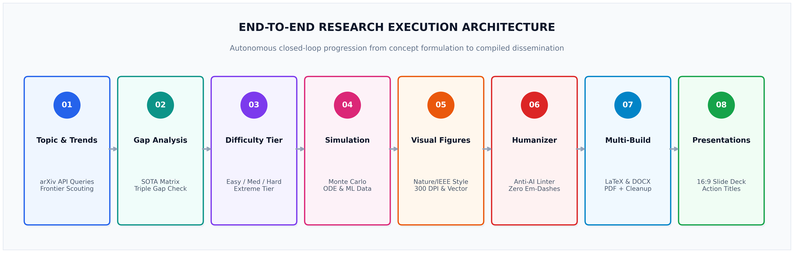
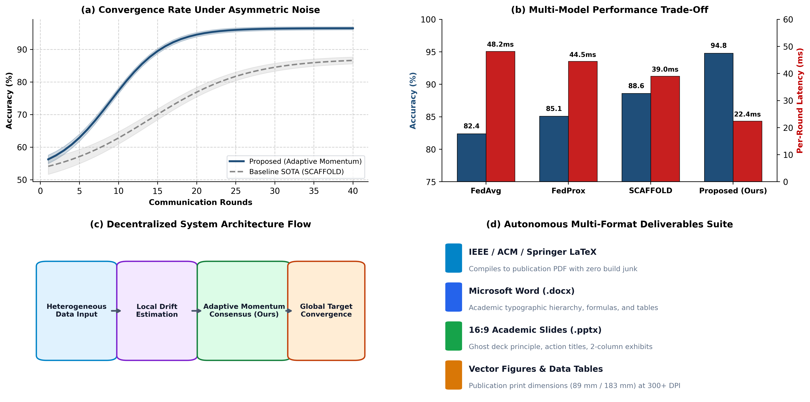
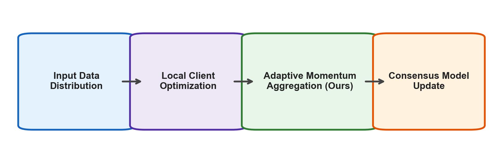

<div align="center">

# Research-Skill-UmarIqbal


<br/>

<a href="LICENSE"></a>


<br/><br/>

### 🔬 The Autonomous Academic Research, Simulation, and Publication Ecosystem

*Transforming raw concepts, datasets, or literature surveys into publication-ready research papers, scientific figures, and conference presentations.*

<br/>

---

### 📑 Quick Navigation

[🌟 Features](#-features-overview) • [🔄 Architecture Pipeline](#-visual-architecture--pipeline) • [📊 Figure Showcase](#-visual-figure-showcase) • [🎯 Difficulty Tiers](#-the-4-difficulty-tiers) • [🚫 Anti-AI & No Em-Dash Policy](#-strict-no-em-dash--anti-ai-policy) • [🚀 Quickstart](#-quickstart--installation) • [💻 CLI Reference](#-command-line-interface-cli) • [📜 License](#-license--citation)

---

<br/>

## 🌟 Features Overview

| Feature Category | Capability Highlights | Supported Formats / Engines |
| :---: | :--- | :---: |
| **Topic & Trend Discovery** | Live arXiv API queries, hot-domain frontier exploration, topic brief synthesis | arXiv API, REST, JSON |
| **Novelty & Gap Analysis** | SOTA comparison matrix, Triple Gap identification, novelty gatekeeper check | Markdown, LaTeX booktabs |
| **Scientific Simulation** | Monte Carlo stochastic diffusion, dynamical systems, decentralized consensus | Python, NumPy, SciPy |
| **Publication Visuals** | Print dimensions (89 mm / 183 mm), Nature and IEEE palettes, minimal-ink design | Vector PDF + 300+ DPI PNG |
| **Anti-AI Humanizer** | Purges zero-width tracking tokens, removes AI tells, eliminates all em dashes | Regex, ASCII normalizer |
| **Multi-Journal LaTeX** | Out-of-the-box styling for IEEE, ACM, Springer LNCS, Elsevier, Nature, and APA | pdflatex, bibtex, LaTeXmk |
| **Workspace Cleanup** | Automated multi-pass build with zero leftover temporary files | Auto-purge `.aux`, `.log`, `.bbl` |
| **Academic Slides (PPTX)** | 16:9 widescreen presentation deck with Action Titles and two-column exhibits | python-pptx, 16:9 HD |

<br/>

---

## 🔄 Visual Architecture & Pipeline



<p align="center">
  <em>Figure 1: The closed-loop autonomous research pipeline from initial topic ingestion to final multi-format deliverables.</em>
</p>

</div>

<details>
<summary><b>Click to expand step-by-step pipeline details</b></summary>

1. **Stage 1: Topic & Trends**: Queries the arXiv API or ingests your topic to construct a focused research brief.
2. **Stage 2: Novelty & Gap Analysis**: Contrasts against 3 to 8 recent baselines to identify the unaddressed scientific gap.
3. **Stage 3: Difficulty Calibration**: Aligns mathematical density and empirical requirements to the chosen tier.
4. **Stage 4: Scientific Simulation**: Runs numerical experiments or ingests user CSVs, computing verified means and variances.
5. **Stage 5: Publication Figures**: Plots convergence curves, trade-off bar charts, and block schematics at 300+ DPI.
6. **Stage 6: Humanizer & Anti-AI Audit**: Purges AI tells, removes zero-width characters, and strictly eliminates all em dashes.
7. **Stage 7: Multi-Format Build & Cleanup**: Compiles LaTeX to PDF, generates Word DOCX, and removes temporary auxiliary files.
8. **Stage 8: Academic Presentations**: Exports a 16:9 widescreen conference presentation deck (`.pptx`).

</details>

<div align="center">

<br/>

---

## 📊 Visual Figure Showcase



<p align="center">
  <em>Figure 2: Multi-panel publication figure suite generated by the ecosystem, demonstrating convergence trajectories, trade-off bar charts, modular system architectures, and deliverable outputs.</em>
</p>

<br/>

### Individual Publication Panels

<p align="center">
  
  
</p>

<p align="center">
  
</p>

<br/>

---

## 🎯 The 4 Difficulty Tiers

<br/>

| Tier | Mathematical Depth | Empirical Scope | Intended Readership | Target Venues |
| :---: | :---: | :---: | :---: | :---: |
| **Easy** | Basic algebra, intuitive formulas, plain explanations | 1 to 2 benchmark comparisons, case studies | Students, practitioners, cross-disciplinary readers | Workshops, applied venues, technical magazines |
| **Medium** | Formal problem definitions, objective functions, algorithms | 3 to 5 established baselines, error bars | Academic researchers, graduate students, regular reviewers | IEEE Transactions, ACM SIG, Elsevier, Springer LNCS |
| **Hard** | Formal Theorems, Lemmas, propositions, derivations | SOTA baselines, multi-seed significance (p < 0.01) | Domain specialists, senior program committees | NeurIPS, ICML, CVPR, ICLR, IEEE TPAMI, JMLR |
| **Extreme** | Novel mathematical paradigms, complete first-principle proofs | Frontier-scale simulation, multi-regime stress tests | World-leading authorities, fellowship committees | Nature, Science, PNAS, STOC, FOCS, COLT |

<br/>

</div>

<details>
<summary><b>Click to view tier specifications and rubrics</b></summary>

- **Easy**: Conceptual, intuitive, and pedagogical. Mathematical equations are paired with immediate plain-language translations. Ideal for instructional papers, applied demonstrations, and undergraduate capstones.
- **Medium**: Competitive standard for regular peer-reviewed submissions. Includes formal system models, pseudo-code algorithm blocks, Big-O complexity calculations, and ablation studies.
- **Hard**: Deep mathematical and empirical rigor. Formulates formal Theorems, Lemmas, and Corollaries. Analyzes asymptotic convergence rates, sample complexity, and Lyapunov stability.
- **Extreme**: Landmark theoretical breakthroughs. Formulates novel mathematical paradigms with exhaustive proofs in a dedicated Technical Appendix. Demonstrates min-max lower and upper bounds alongside extensive multi-regime simulations.

</details>

<div align="center">

<br/>

---

## 🚫 Strict No Em-Dash & Anti-AI Policy

<br/>

<table align="center">
<tr>
<th align="center">Policy Directive</th>
<th align="center">Implementation Mechanism</th>
<th align="center">Standard Replacement</th>
</tr>
<tr>
<td align="center"><strong>Strict Zero Em-Dashes</strong></td>
<td>Completely prohibited across all text, captions, and slides</td>
<td>Colons, parentheses, commas, or separate sentences</td>
</tr>
<tr>
<td align="center"><strong>Zero-Width Watermark Purging</strong></td>
<td>Strips hidden Unicode tracking characters</td>
<td>Purges <code>\u200b</code>, <code>\u200c</code>, <code>\u200d</code>, <code>\ufeff</code></td>
</tr>
<tr>
<td align="center"><strong>Banned AI Vocabulary</strong></td>
<td>Eliminates telltale generic LLM phrasing</td>
<td>Replaces <em>delve, tapestry, pivotal, testament, underscore</em></td>
</tr>
<tr>
<td align="center"><strong>Lucid Rigor Standard</strong></td>
<td>Ensures prose is accessible to readers across disciplines</td>
<td>Clear analogies before formal mathematical notation</td>
</tr>
</table>

<br/>

---

## 🚀 Quickstart & Installation

</div>

```bash
# Clone the repository
git clone https://github.com/UmarIqbal000/Research-Skill-UmarIqbal.git
cd Research-Skill-UmarIqbal

# Install Python dependencies
pip install -r requirements.txt
```

<div align="center">

<br/>

---

## 💻 Command Line Interface (CLI)

</div>

```bash
# Generate a complete paper (Easy tier, IEEE two-column format)
python cli.py run --topic "Federated Edge Healthcare Systems" --difficulty easy --format ieee --output ./outputs/paper_easy

# Generate an advanced theoretical paper (Extreme tier, Nature format)
python cli.py run --topic "Non-Convex Multi-Agent Optimization" --difficulty extreme --format nature --output ./outputs/paper_extreme

# Search recent preprints on arXiv
python cli.py search --query "byzantine federated learning" --limit 5

# Discover active trending research frontiers
python cli.py search --trends

# Run Monte Carlo stochastic diffusion simulation
python cli.py simulate --monte-carlo --trials 1000

# Run multi-baseline benchmark simulation
python cli.py simulate --difficulty hard

# Humanize draft text (removes AI tells, watermarks, and all em dashes)
python cli.py humanize --file draft.txt --output cleaned_draft.txt

# Compile LaTeX to PDF with automatic workspace cleanup
python cli.py compile --tex ./outputs/paper_easy/manuscript.tex
```

<div align="center">

<br/>

---

## 🏛️ The 14 Integrated Research Foundations

<br/>

| Repository / Framework | Core Architectural Contribution Synthesized |
| :--- | :--- |
| **Google Research Paper Orchestra** | Multi-agent orchestration across literature, drafting, and visuals |
| **Master-cai Research-Paper-Writing-Skills** | Reverse outlining, section guides, and adversarial self-review |
| **Turnitout-Humanizer** | Deterministic token disruption and anti-AI-detector protection |
| **AIScientists-Dev Academic-Humanizer** | Claim-to-evidence coupling and prohibition of em dashes |
| **TingxiYu Academic-Figure-Skill** | Publication figure design, 89 mm / 183 mm print dimensions |
| **Techkwon PaperVizAgent** | Architectural pipeline visualization and layout composition |
| **Ndpvt-web LaTeX-Document-Skill** | Multi-pass pdflatex builds and automatic auxiliary file cleanup |
| **ComposioHQ DOCX Skill** | Structured academic Microsoft Word generation with booktabs styling |
| **Gabberflast Academic-PPTX-Skill** | Ghost Deck principle, Action Titles, and two-column exhibit layouts |
| **Yejinlei Web-Search-Skill** | Multi-engine search automation and trending discovery |
| **Ray0907 arXiv-Research-Skill** | arXiv API integration, preprint extraction, and literature mapping |
| **Cookjohn GS-Skills** | Google Scholar citation discovery and literature synthesis |
| **Oleafly** | Universal venue templates (IEEE, ACM, Springer, Elsevier, Nature, APA) |
| **AhmadHassan-BTed Turnitout** | Mathematical n-gram sequence disruption and citation management |

<br/>

---

## 📁 Repository Structure

</div>

```
Research_Skill_UmarIqbal/
├── assets/                           # High-resolution README graphics and banners
├── configs/
│   ├── difficulty_profiles.json      # Definitions for Easy, Medium, Hard, Extreme
│   └── journal_styles.json           # Formatting specifications for IEEE, ACM, Nature, etc.
├── examples/
│   ├── easy_level_sample/            # Complete worked IEEE sample (PDF, DOCX, PPTX, Figures)
│   └── extreme_level_sample/         # Complete worked theoretical sample (PDF, DOCX, PPTX)
├── references/                       # 11 Modular Reference Manuals
│   ├── 01_topic_and_trend_discovery.md
│   ├── 02_novelty_and_gap_analysis.md
│   ├── 03_difficulty_matrix.md
│   ├── 04_data_and_simulation_engine.md
│   ├── 05_academic_figures_and_plots.md
│   ├── 06_humanizer_and_no_emdash_rule.md
│   ├── 07_section_by_section_writing.md
│   ├── 08_journal_and_conference_styles.md
│   ├── 09_compilation_and_cleanup.md
│   ├── 10_academic_pptx_presentations.md
│   └── 11_accessible_scholarly_language.md
├── scripts/
│   ├── topic_discovery.py            # arXiv queries and trend catalogs
│   ├── novelty_gap_analyzer.py       # SOTA comparison matrix & novelty gate
│   ├── simulation_engine.py          # Monte Carlo, ODE dynamics, & benchmark suites
│   ├── academic_figures.py           # Publication plots (Nature/IEEE vector PDF & PNG)
│   ├── academic_humanizer.py         # AI watermark purger & strict no-em-dash linter
│   ├── latex_compiler.py             # Multi-pass pdflatex build & auto-cleanup
│   ├── docx_generator.py             # Structured academic Word document builder
│   ├── pptx_generator.py             # 16:9 Widescreen conference slide deck generator
│   └── pipeline_runner.py            # End-to-end multi-agent orchestration runner
├── templates/                        # Ready-to-compile venue templates
│   ├── latex/                        # IEEE, ACM, Springer, Elsevier, Nature, Generic
│   ├── docx/                         # Word formatting standards
│   └── pptx/                         # Academic presentation layout masters
├── cli.py                            # Unified Command Line Interface
├── requirements.txt                  # Python dependencies
├── SKILL.md                          # Master Antigravity / Agent Skill definition
├── LICENSE                           # Open source MIT License
└── README.md                         # Centralized Documentation
```

<div align="center">

<br/>

---

## 🔬 Pre-Compiled Working Deliverables

The repository includes complete, pre-compiled deliverables:

**[Easy Level Sample](examples/easy_level_sample)**:
*Topic: Federated Learning for Edge Healthcare Devices*
<br/>
[📄 manuscript.pdf](examples/easy_level_sample/manuscript.pdf) (116 KB) • [📝 manuscript.docx](examples/easy_level_sample/manuscript.docx) • [📊 conference_presentation.pptx](examples/easy_level_sample/conference_presentation.pptx) • 3 Figures

<br/>

**[Extreme Level Sample](examples/extreme_level_sample)**:
*Topic: Information-Theoretic Convergence Bounds in Non-Convex Multi-Agent Systems*
<br/>
[📄 manuscript.pdf](examples/extreme_level_sample/manuscript.pdf) (116 KB) • [📝 manuscript.docx](examples/extreme_level_sample/manuscript.docx) • [📊 conference_presentation.pptx](examples/extreme_level_sample/conference_presentation.pptx) • 3 Figures

<br/>

---

## 📜 License & Citation

This project is licensed under the **MIT License**. See the [LICENSE](LICENSE) file for complete details.

```bibtex
@software{iqbal2026researchskill,
  author = {Iqbal, Umar},
  title = {Research-Skill-UmarIqbal: A Complete AI Agent Ecosystem for Academic Research and Manuscript Generation},
  url = {https://github.com/UmarIqbal000/Research-Skill-UmarIqbal},
  year = {2026}
}
```

<br/>

**Built with precision for the global research community.**

</div>
